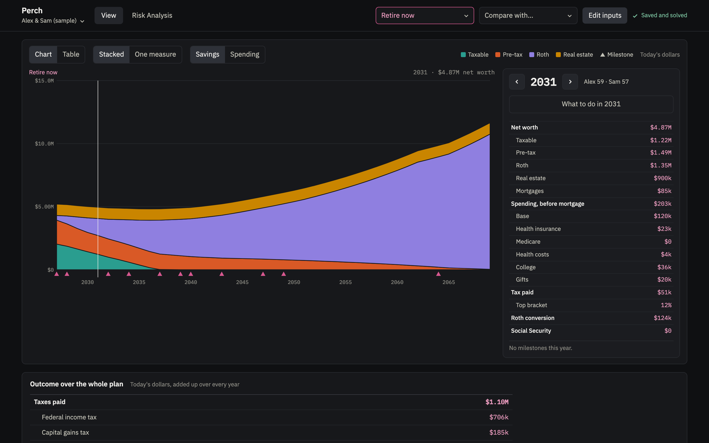
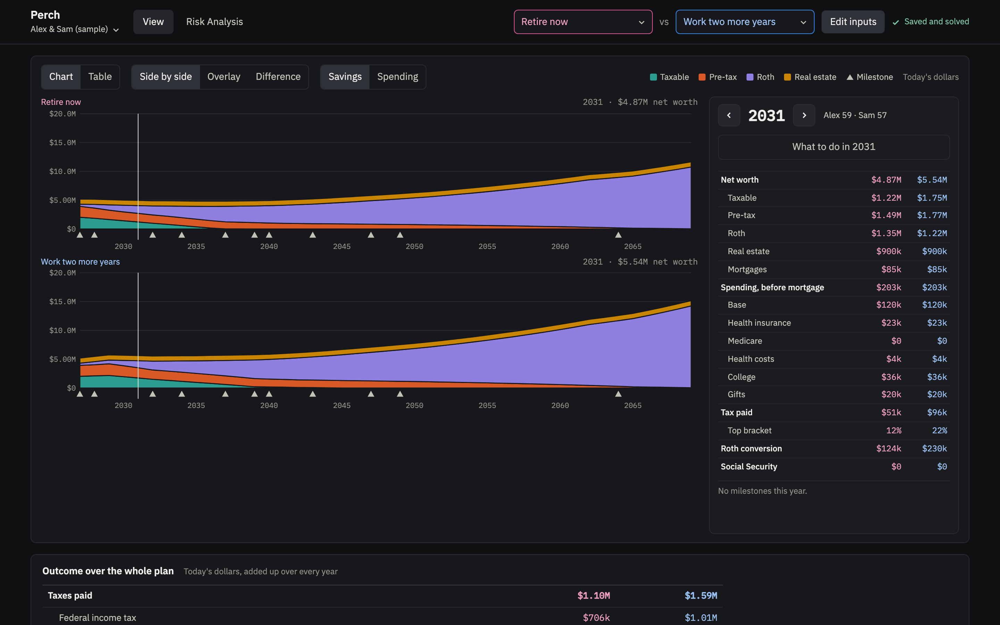
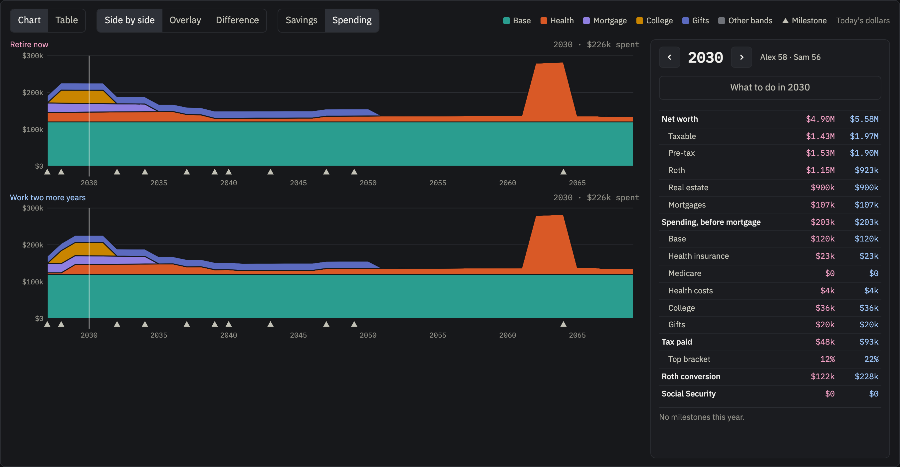
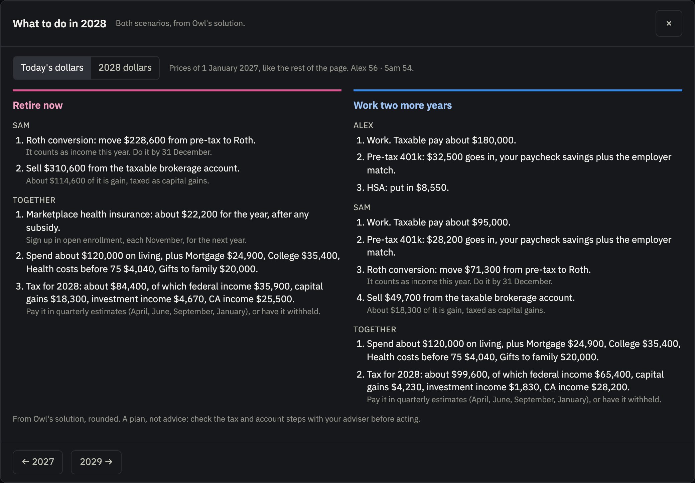
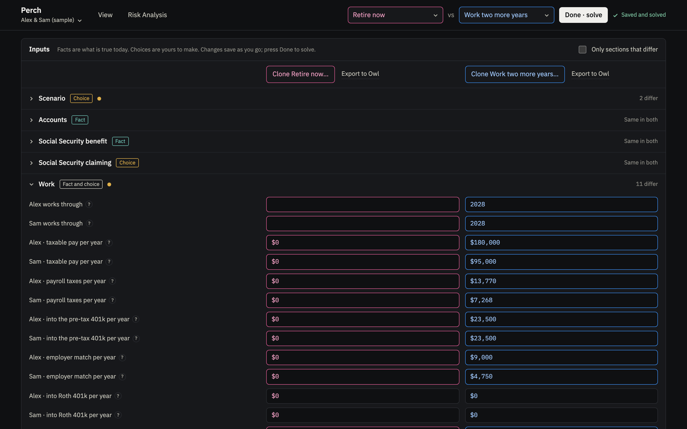
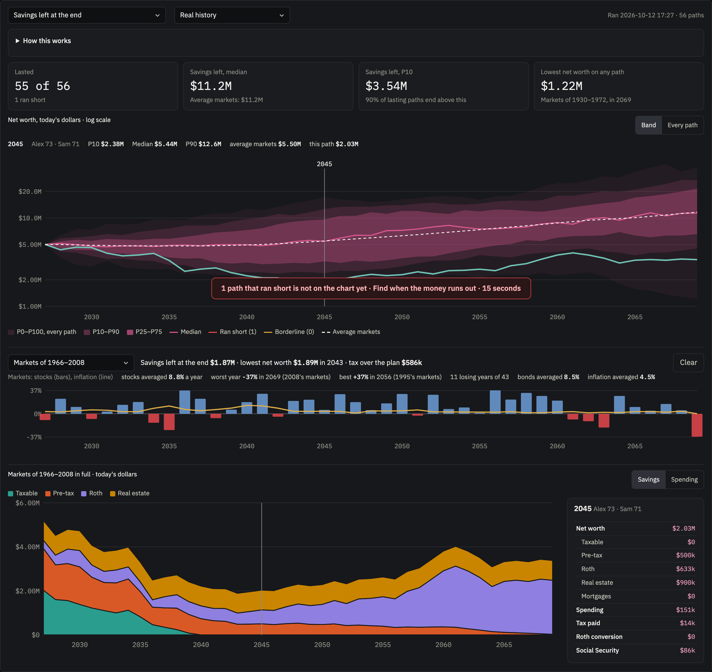
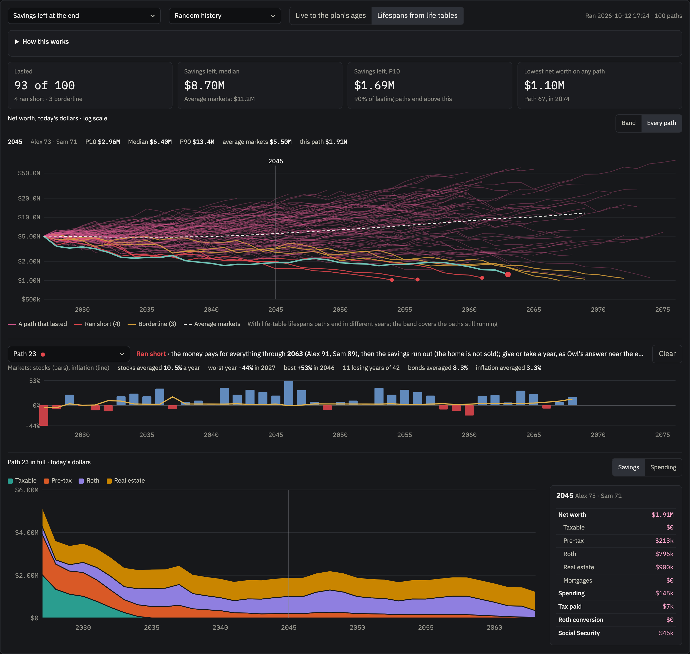
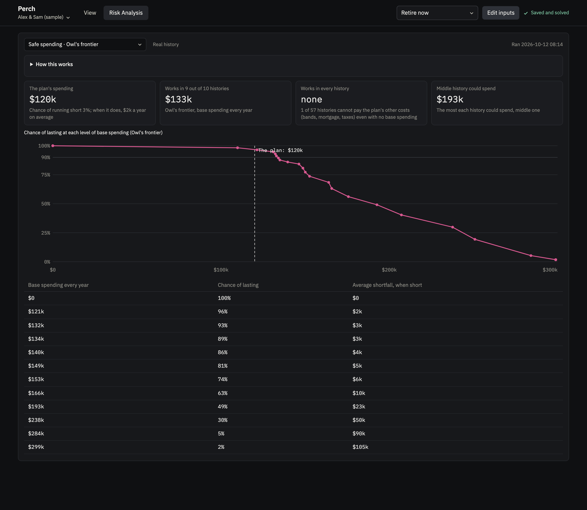

# Perch

**Plan retirement in plain terms on top of Owl: what to do each year, and how the plan holds up
across a hundred possible markets.**

Perch runs on top of [Owl](https://github.com/mdlacasse/Owl), an open-source retirement planner
that optimizes withdrawals, Roth conversions and Social Security timing under US federal and
state tax rules. Owl does every calculation. Perch is where you describe your household in
today's dollars, look at what Owl found, and ask the questions people actually ask: *what do we
do this year?*, *what if we work one more year?*, *what if the markets go badly?*



## What Perch adds to Owl

Owl is the engine, and it has its own app for building and studying one case at a time. Perch is
a second front end that stays on Owl's own code: every number on its pages comes from an Owl
solve.

| | Owl's own app | Perch |
|---|---|---|
| Entering a plan | Balances in the case, plus a yearly table of future-dollar amounts per person | One form in today's dollars; Perch builds Owl's yearly table |
| Work years | Wages entered net of every contribution; payroll taxes not charged | W-2 pay, 401(k), employer match, Roth and after-tax 401(k), HSA and payroll taxes, each handled the way Owl needs |
| Spending | One spending target plus one-off amounts by year | A base amount plus bands by category (health, care, gifts, other), dragged in time on a chart |
| Comparing | Cases one at a time; a text summary of differences | Pick a second plan and it joins every chart, table and input, in its own color |
| Each year | Worksheets of numbers | A to-do list in plain words for each person |
| Risk | Monte Carlo and historical runs with their own settings | Five analyses with plain explanations and time estimates, the markets of each path, and when the money runs out on a path that fails |
| Start of the plan | The current calendar year | 1 January of next year, so a plan made in the autumn starts with the year ahead |

## Features

### View: one plan, or two side by side

The page has two tabs, **View** and **Risk Analysis**.

- View shows one scenario. To compare, pick another in *Compare with…* next to it; each plan
  then has its own color (pink and blue) in every chart, table and input. *None* goes back to one.
- Net worth by account (taxable, pre-tax, Roth, real estate), or spending by category, by year.
- One measure at a time: net worth, spending, health costs, tax, Roth conversions or Social
  Security, for one plan or both overlaid, or, with two plans, the difference between them.
- A table of every year, and a card for the year under the cursor: balances, spending by
  category, tax, top bracket, conversions, Social Security and milestones (Medicare, required
  withdrawals, Social Security start, mortgage paid off, college, last year of work).
- The outcome over the whole plan: taxes by kind, Social Security received, Roth conversions,
  and what goes to the children: college, gifts while alive, the estate, estate tax above the
  exemption, and the income tax heirs owe on inherited pre-tax money.
- How the plan held up across markets, for each Risk analysis already run: how many paths
  lasted, savings left in the bad case (P10), and the spending that works in 9 of 10 histories,
  marked when the plan has changed since. Each line opens that analysis.





### What to do each year

Click a year for each person's moves in plain words: how much to convert to Roth, what to sell
from the brokerage account and how much of it is taxable gain, the required withdrawal and
anything taken on top, when to start Social Security, what goes into the 401(k) and HSA, health
insurance or Medicare, the year's spending, and the tax bill by kind with when to pay it. In
today's dollars, or in that year's dollars as a transfer would show them.



### A form in plain terms

- Facts, choices and assumptions are labeled as such; every field has plain help; fields that
  do not apply stay hidden.
- **Accounts:** joint and personal taxable money with its cost, pre-tax and Roth balances.
- **Social Security:** each person's benefit at full retirement age; Owl can choose the
  claiming ages.
- **Work:** the last year of work, W-2 pay, payroll taxes, the pre-tax 401(k), employer match,
  Roth and after-tax 401(k) moved to Roth, and the HSA. The employer's health plan covers the
  household until the last paycheck; marketplace insurance starts the year after.
- **Real estate:** homes and rentals, mortgages, rental income, growth, and a year to sell.
- **Children and college:** each child's start year, years and cost, which can grow faster
  than prices.
- **Spending:** a base amount, extra bands by category over chosen years, and the shape over
  time (flat or Owl's smile).
- **Market, health and plan settings:** historical or chosen returns, the stock-and-bond mix
  now and later, the marketplace premium and how much faster health costs grow than prices,
  what Owl maximizes, and how long the plan runs.
- Edits save as you go; *Done* solves the changed plans. Clone a plan to try a variation.



### Risk Analysis

Test one plan against many possible futures. Each analysis says what question it answers, how
it works, whose method it is, and how long it will take on your computer, measured from earlier
runs. Results are kept until the plan changes.

| Analysis | The question | Method |
|---|---|---|
| Savings left at the end | Does the money last, and how much is left? | One Owl solve per path |
| Safe spending · Perch | How much could we spend every year and still last? | Owl finds the most each path can spend; Perch counts the paths that afford each level |
| Safe spending · Owl's frontier | The same, with the chance and size of a shortfall | Owl's own spending optimization, unchanged |
| January conversion · quick check | How much does this January's Roth conversion matter? | Each history solved with hindsight, then with the first conversion locked at a range of amounts |
| January conversion · Owl's sweep | The same, with the value of converting at all | Owl's own conversion regret sweep, unchanged |

- **Markets:** every stretch of real history; random history (Owl's historical bootstrap);
  or Owl's model of calm and stormy spells (GARCH), fitted to that history.
- **Lifespans:** to the plan's ages, or drawn for each path from Owl's life tables.
- **Each path:** net worth across all paths as a band (every path, P10–P90 and P25–P75), or
  every path as its own line, with the paths that run short or just about last marked. Click a line, or pick a path, to see the market
  it lived through (stocks and inflation each year, average, best and worst years) and the path in
  full, as View shows a plan: savings by account or spending by kind each year, and the numbers
  for the year under the pointer. These sit under the chart and keep their place.
- **Paths that run short:** one button on the chart finds, for all of them at once, the last year
  each still pays for everything, with a time estimate.







### Households

- A household is one person or a couple, with names, birth years, sex for life expectancy, and
  a state picked from those Owl has tax tables for.
- Switch households, or start a new one, from the menu under the Perch name. A new household
  starts with one scenario whose facts are empty.

### Export to Owl

Any scenario downloads as the case file and workbook Owl's own app opens, for the tools Perch
does not show: Owl's other market models, spending-versus-bequest curves, its full workbooks,
pensions and annuities, and charitable gifts from an IRA.

## Getting started

```sh
git clone --recursive https://github.com/finik/perch.git
cd perch
./setup.sh          # fetches Owl and installs it with uv
python3 perch.py    # then open http://localhost:8790
```

You need Python 3.10 or later and [uv](https://docs.astral.sh/uv/). There is no build step.

The first run opens with two made-up households: a couple, Alex and Sam, and Alex on their own,
each with two scenarios, *Retire now* and *Work two more years*. To plan for yourself, pick
*New household…* from the menu under the Perch name.

## Your data stays on your computer

Scenarios live in `~/.perch-scenarios`, outside the code folder, so nothing personal can end up
in a commit. Each household has its own folder. Your inputs are kept apart from what Owl works
out from them, which sits in a `cache` folder that can be cleared at any time (*Clear saved
results…* in the household menu); Perch then solves the plans again.

```
~/.perch-scenarios/
  timings.json                how long runs took here, for the time estimates
  alex-and-sam/
    household.json            names, birth years, state
    retire-now.json           one scenario's inputs
    work-two-more-years.json
    cache/
      solves/                 Owl's plan for each scenario
      risk/retire-now/        Risk Analysis runs for that scenario
  alex/
    ...
```

The first run creates the folder from the samples and never overwrites one that exists.
`python3 perch.py init` creates it without starting the server.

## Running analyses from the command line

Every analysis on the Risk page can also be run from a terminal, for one scenario or every
scenario of a household; the results show on the page as if run there.

```sh
python3 perch.py run alex-and-sam/retire-now history random runout
python3 perch.py run alex-and-sam spend owl-frontier
python3 perch.py run --help        # the list of analyses
```

## Settings

| Variable | Default | |
|---|---|---|
| `PERCH_DATA` | `~/.perch-scenarios` | where households and scenarios live |
| `PERCH_HOST` | `127.0.0.1` | `0.0.0.0` to open Perch from a phone or another computer |
| `PERCH_PORT` | `8790` | |
| `OWL_HOME` | `vendor/Owl` | another Owl checkout, with its own `.venv` |

## How it is built

```
perch.py            the server, the input form, and the Risk runs
web/index.html      the page: plain HTML, CSS and JavaScript
engine/
  build_hfp.py      writes the yearly workbook Owl reads
  solve.py          one Owl solve, returning the yearly series the page shows
  owl_tools.py      runs Owl's own spending frontier and conversion sweep
  clock.py          starts Owl's plan on 1 January of the scenario's first year
  rules.json        the few rules the page uses itself, such as the Medicare age
samples/            the sample households and scenarios
vendor/Owl          Owl, as a git submodule on its development branch
```

## License

GPL v3, the same as Owl. See [LICENSE](LICENSE).

## Not advice

Perch shows what Owl's model says under the assumptions you enter. It is not tax, legal or
investment advice.
